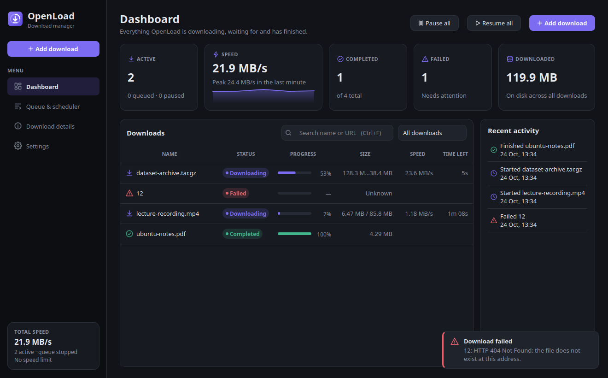
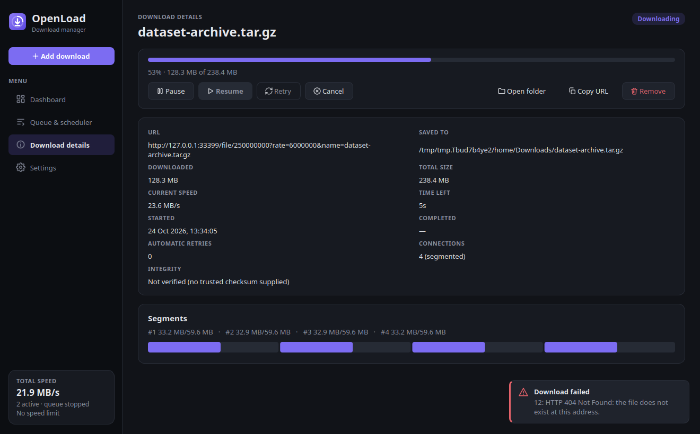
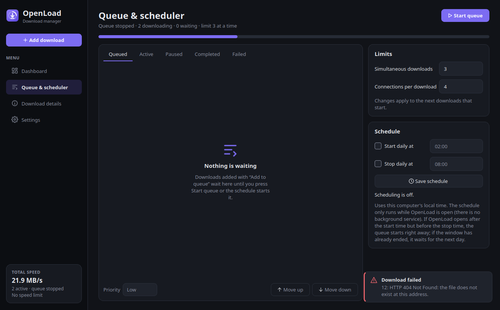
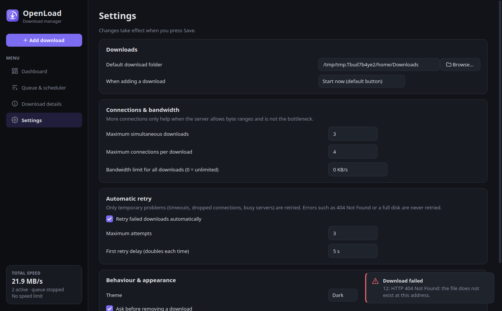

# OpenLoad

**OpenLoad** is an open-source desktop download manager for **Linux and Windows**, written in **C++17** with **Qt 6 Widgets**, **libcurl** and **SQLite**. It resumes interrupted downloads safely, uses several connections when a server allows it, queues and schedules downloads, and keeps a persistent history. It needs no account and no cloud service.

It began as a first-semester Programming Fundamentals project at SEECS, NUST. Its feature set was inspired by the publicly described features of Internet Download Manager and implemented clean-room (see [docs/FEATURE_RESEARCH.md](docs/FEATURE_RESEARCH.md)). OpenLoad is not affiliated with or compatible with IDM.



| Download details (4 segments) | Queue & scheduler | Settings |
|---|---|---|
|  |  |  |

*The screenshots were produced by `tools/capture_screenshots.sh` from real application state, using real downloads from the local test server.*

## Features

- **Real HTTP/HTTPS downloads** with live progress, a smoothed speed, and an ETA shown only when it is meaningful.
- **Pause and resume** with `Range` and `If-Range`. Every `206` response is checked against the requested `Content-Range`. If the server ignores the range or the file changed, the download restarts cleanly; data is never blindly appended.
- **Segmented downloads** (up to 16 connections). Each segment goes to its own file, every range is verified, and the file is assembled before the final rename. OpenLoad falls back to one connection automatically when the server ignores ranges.
- **Queue:** priority then FIFO, simultaneous-download limit, Start/Stop queue, Move up/down, duplicate prevention.
- **Scheduler:** daily start and optional stop time (windows across midnight are supported), with a documented missed-start policy.
- **Automatic retry:** bounded exponential backoff for transient errors only. `Retry-After` is honoured. 404, 403, TLS and disk errors are never retried.
- **Global bandwidth limit**, shared across running downloads.
- **Persistence and recovery:** SQLite history with migrations. Downloads interrupted by a crash or by closing the app come back as *Interrupted* and are revalidated before resuming.
- **Integrity:** optional SHA-256 verification against a checksum you supply (shown as *Verified*, *Mismatch* or *Not verified*).
- **Safety:** http/https only, including redirects. TLS verification is always on. Server-supplied file names are sanitised, and existing files are never overwritten.
- **Polished UI:** dark and light themes, statistics with a live speed graph, search and filters, context menus, keyboard shortcuts and empty states.

## Technology

| | |
|---|---|
| Language | C++17 |
| GUI | Qt 6 Widgets (+ Qt Svg, Qt Concurrent) |
| Networking | libcurl (easy and multi interfaces) |
| Storage | SQLite 3 (raw C API, prepared statements), `QSettings` |
| Build | CMake ≥ 3.21 with presets, Ninja |
| Tests | Qt Test + CTest + a local Python standard-library HTTP server |

## Architecture

```
openload (main.cpp)
 └─ openload_ui      MainWindow, five screens, Theme, model/delegate, widgets
     └─ openload_engine
          app/        DownloadManager (life cycle, retries, persistence)
          network/    DownloadWorker (one QThread each), HttpProbe, HttpDownloader, SegmentDownloader
          scheduler/  DownloadQueue, Schedule/Scheduler
          storage/    Database (migrations), DownloadRepository, SettingsRepository
          core/       DownloadTask, TaskState, validation, formatting, retry policy, rate limiter, ...
          platform/   data paths, launch at login
```

Workers never touch widgets; they report through queued signals. See [docs/ARCHITECTURE.md](docs/ARCHITECTURE.md).

## Building on Linux

Tested on Ubuntu 26.04. Any distribution with Qt ≥ 6.2, libcurl ≥ 7.85 and CMake ≥ 3.21 should work.

```bash
sudo apt install build-essential cmake ninja-build pkg-config \
                 qt6-base-dev qt6-svg-dev libcurl4-openssl-dev libsqlite3-dev python3
git clone https://github.com/tehsaad/OpenLoad.git && cd OpenLoad
cmake --preset linux-release
cmake --build --preset linux-release
./build/linux-release/src/openload
```

Debian packaging (`.deb`) lives on the `feature/linux-desktop` branch; see `packaging/linux/README.md` there.

## Building on Windows

You need Visual Studio 2022 (MSVC), CMake, Ninja, Qt 6 for MSVC 2022 64-bit, and curl and sqlite3 from vcpkg:

```powershell
vcpkg install curl:x64-windows sqlite3:x64-windows
cmake --preset windows-msvc -DCMAKE_TOOLCHAIN_FILE=%VCPKG_ROOT%/scripts/buildsystems/vcpkg.cmake -DCMAKE_PREFIX_PATH=C:/Qt/6.8.3/msvc2022_64
cmake --build --preset windows-msvc
```

Run this from a "x64 Native Tools" prompt. The installer (NSIS) and the GitHub Actions workflow that builds it live on the `feature/windows-desktop` branch; see `packaging/windows/README.md` there.

## Usage

Click **Add download** (Ctrl+N), paste a link, then choose **Start now** or **Add to queue**. See the [User Guide](docs/USER_GUIDE.md). From a terminal: `openload --add <url>`.

## Testing

```bash
cmake --preset linux-debug && cmake --build --preset linux-debug && ctest --preset linux-debug
```

Six suites cover the engine, storage, queue, network behaviour (ranges, ignored ranges, wrong `Content-Range`, changed files, errors, cancellation, segmentation) and the GUI. On 2026-10-24 all 6 passed (135 QtTest results). The worst measured GUI stall during an active download was 14 ms. Details, and an honest benchmark of when multiple connections help, are in [docs/TESTING.md](docs/TESTING.md).

## Known limitations

- No browser extension yet. Use `openload --add <url>`. The security design is in [docs/SECURITY.md](docs/SECURITY.md).
- No authenticated downloads (cookies, HTTP auth) and no FTP.
- The scheduler only runs while OpenLoad is open.
- One queue. The segmentation is static: segments are not re-split while running.
- Changing "connections per download" affects downloads when they next start.
- Segmented assembly needs temporary extra disk space (up to the file size) and an extra copy.
- Only one OpenLoad window per user at a time is supported: running two instances on the same database is not prevented.

## Roadmap

1. Browser hand-off over native messaging (opt-in, token-protected).
2. Single-instance guard, with `--add` forwarding to the running window.
3. Per-category download folders.
4. Dynamic re-segmentation of slow segments.
5. A system tray icon and desktop notifications.

## Documentation

[Architecture](docs/ARCHITECTURE.md) · [Feature research](docs/FEATURE_RESEARCH.md) · [User guide](docs/USER_GUIDE.md) · [Testing](docs/TESTING.md) · [Security](docs/SECURITY.md) · [PF concept mapping](docs/PF_CONCEPT_MAPPING.md) · [Demo script](docs/DEMO.md) · [Contributing](CONTRIBUTING.md) · [Changelog](CHANGELOG.md)

## License

MIT; see [LICENSE](LICENSE). Icons and artwork are original to this project. Qt is used under the LGPL v3, libcurl under the curl license, and SQLite is public domain.
